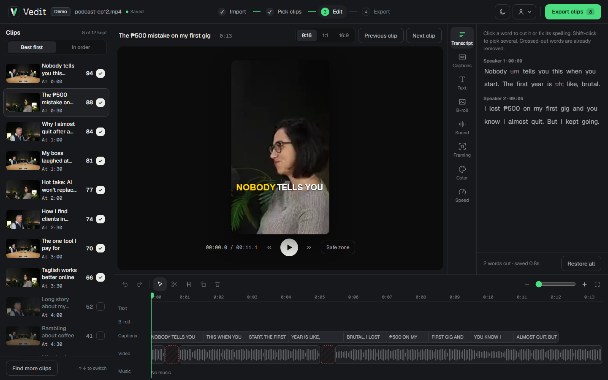
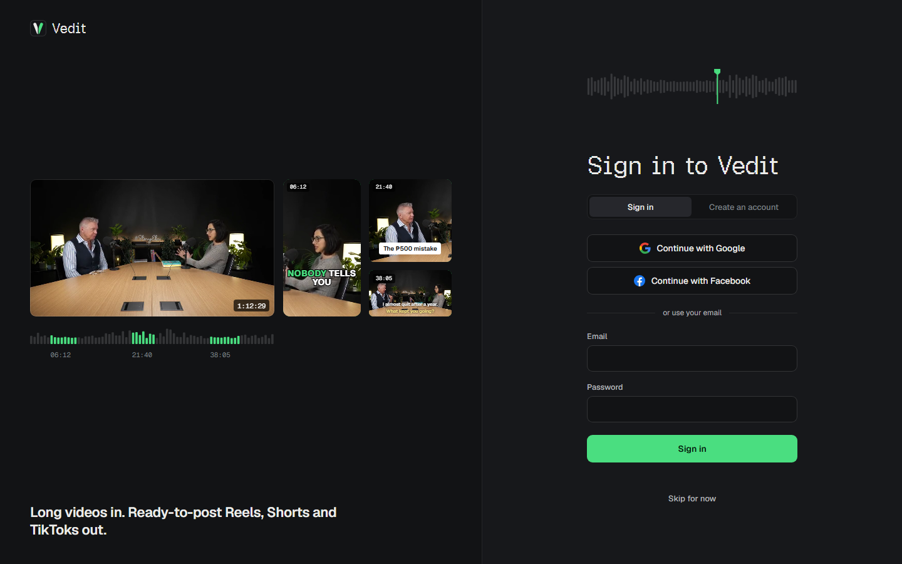
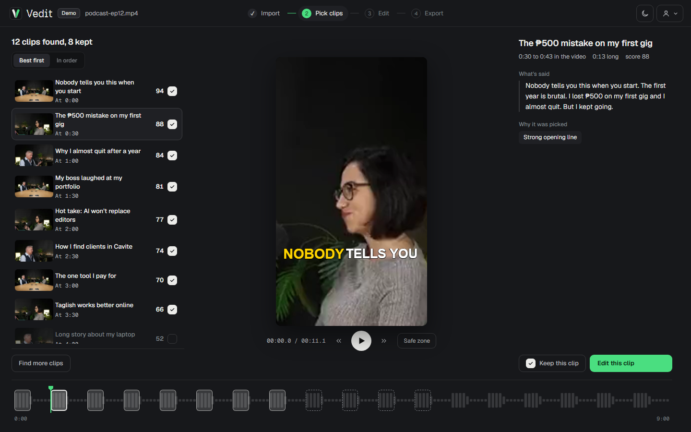
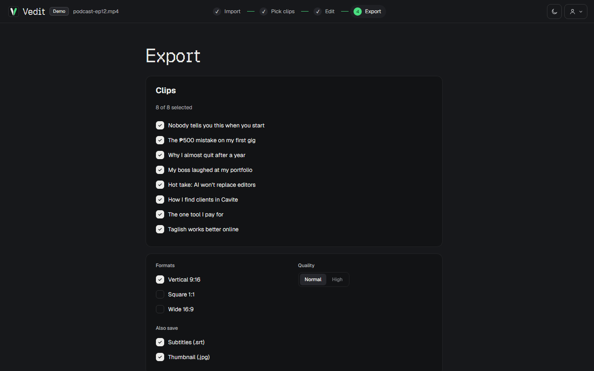

<div align="center">

# Vedit

**An open-source AI video editor for content creators. Raw footage in, finished video out.**

**Not a coder? 👉 [START HERE](START_HERE.md): download, double-click to install, drag your video in. Works in English, Filipino and Taglish.**

[](https://github.com/onetwothird/vedit/actions/workflows/ci.yml)
[](https://www.python.org/)
[](https://ffmpeg.org/)
[](LICENSE)
[](SKILL.md)

[Features](#features) ·
[Installation](#installation) ·
[Quick start](#quick-start) ·
[Vedit Studio](#option-c-vedit-studio-desktop-app) ·
[Fact Reels kit](#make-fact-reels-from-your-own-footage) ·
[Commands](#command-reference) ·
[How it works](#how-it-works) ·
[Contributing](#contributing)



</div>

---

## Overview

Editing a talking-head video takes hours of repetitive work: cutting pauses and filler words, removing bad takes, adding captions, reframing for vertical platforms, balancing audio and making thumbnails.

**Vedit automates that work.** It runs as:

- **A desktop app, Vedit Studio.** Import a long video, pick the best clips, edit them with one rail of tools, export.
- **A command-line tool.** One command turns a raw recording into a platform-ready video.
- **A [Claude Code](https://docs.claude.com/en/docs/claude-code) skill.** Claude reads the word-level transcript, looks at frames from the video, and makes editorial decisions: picking the hook, removing tangents, choosing the best moments for Shorts. Then it renders the result.

```bash
vedit auto raw.mp4 --preset youtube --formats 9:16 --thumbs
```

Every edit is stored as a plain JSON file (`edl.json`, an *edit decision list*). That makes edits reviewable, repeatable, version-controllable, and easy for both people and AI to change.

## Features

### Editing
- **Smart cuts.** Removes dead air, filler words (*um*, *uh*) and flubbed takes, keeping the final take. Cuts are word-accurate, so a word is never cut in half.
- **Jump-cut masking.** Alternating punch-in zooms hide cuts in single-camera footage.
- **Platform presets.** YouTube, Shorts, TikTok, Reels, LinkedIn (square), podcast, tutorial.
- **Multi-format export.** Render one edit as 16:9, 9:16, 1:1 and 4:5, with face-aware cropping.
- **Overlays.** Titles, lower thirds, b-roll, picture-in-picture, images, sound effects.
- **Motion and color.** Ken Burns zoom and pan, speed ramps, fades, color adjustment, 3D LUTs.

### Captions
- Animated word-by-word captions (`pop`, `box`) or standard subtitles (`clean`)
- `.srt` export for upload to YouTube and other platforms
- Custom spelling fixes and caption colors per speaker

### Audio
- Voice enhancement (compression and presence EQ) and optional noise reduction
- Background music that ducks automatically under speech
- Loudness normalization to platform targets (EBU R128)

### Creator tools
- **Brand kit.** Fonts, caption colors, logo watermark, intro/outro, music and LUT, applied to every video
- **Thumbnails.** Scores frames for sharpness, exposure and faces, then builds a 1280×720 thumbnail with a title
- **YouTube chapters.** Generated from the edit timeline
- **Batch processing.** Edit a whole folder in one command

### Podcasts and multicam
- Camera synchronization by audio cross-correlation
- Active-speaker detection from separate microphones, for automatic camera switching

### Story mode
- Turn **photos plus a script** into a voiced, captioned video or skit
- A different AI voice per character: free [edge-tts](https://github.com/rany2/edge-tts) voices, or OpenAI, ElevenLabs or Piper
- Automatic close-ups on whoever is speaking, scene transitions, titles and sound effects
- **Continuous narration**: the whole script is voiced in one take and long TTS pauses are tightened, so it flows like a real narrator
- **Pronunciation fixes** (`say`): the voice reads a phonetic spelling while the subtitle shows the real one, kept word-for-word in sync
- **Motion-graphics cards**: flat fact cards are split into elements that pop in, pulse on each line and snap out

### Fact Reels kit
- **Make "Did you know?" fact Reels from your own raw photos and clips.** You bring
  plain footage and the tool adds the animated cards, narration, word-by-word subtitles, sound effects and music
- Three scene types: card/photo + AI narration, raw B-roll + AI narration, and **you talking on camera**
  (your real voice, auto-transcribed into subtitles)
- Your own name and colors from one `brand.json`; a card background is generated for you
- [Step-by-step guide](templates/fact_reels/README.md)

## Requirements

| Requirement | Notes |
|---|---|
| Python 3.9+ | |
| FFmpeg | Must include `libass` (standard builds do) |
| *Optional:* NVIDIA GPU | Speeds up transcription automatically |
| *Optional:* `OPENAI_API_KEY` / `ELEVENLABS_API_KEY` | Premium voices in story mode |

## Installation

### Windows, no coding (easiest)

Double-click **`1_INSTALL.bat`** (it installs Python, FFmpeg and everything else), then drag a video onto
**`2_MAKE_VIDEO.bat`**. See [START_HERE.md](START_HERE.md).

### Any computer, no coding: `easy.py`

After installing (below), run **`easy.py`**. It asks you to drag a video into the window, asks where you'll
post it and which language you speak, then makes the video. Same on Windows, macOS and Linux:

```bash
python easy.py            # Windows
python3 easy.py           # macOS / Linux
```

In **VS Code**: open the vedit folder, open `easy.py`, press the **Run** (▷) button at the top right, then
answer the questions in the terminal panel. `2_MAKE_VIDEO.bat` uses `easy.py` too.

### Manual install (Windows, macOS, Linux)

**1. Install FFmpeg**

```bash
winget install Gyan.FFmpeg      # Windows
brew install ffmpeg             # macOS
sudo apt install ffmpeg         # Debian / Ubuntu
```

Open a **new** terminal afterwards so `PATH` refreshes.

**2. Install Vedit**

```bash
git clone https://github.com/onetwothird/vedit.git
cd vedit
pip install -e ".[all]"
```

If `git clone` says the folder already exists, you already have it: just `cd vedit` and `git pull`.

**3. Verify the setup**

```bash
vedit doctor
```

You should see `ready` at the end. The `OPENAI_API_KEY` / `ELEVENLABS_API_KEY` lines are optional.

> **`'vedit' is not recognized` (Windows)?** pip installed the command into a folder that is not on your `PATH`
> (look for the *"script vedit.exe is installed in ... which is not on PATH"* warning). Pick one fix:
>
> - **Run it without the command.** From the `vedit` folder, replace `vedit` with `python scripts\vedit.py`:
>   `python scripts\vedit.py doctor`
> - **Add the folder to PATH** (run once, then open a new terminal), using the folder named in the warning:
>   `setx PATH "%PATH%;%APPDATA%\Python\Python312\Scripts"` (change `Python312` to your Python version)
> - **Use a virtual environment**, whose scripts folder is on `PATH` once activated:
>   `python -m venv .venv`, then `.venv\Scripts\activate`, then `pip install -e ".[all]"`
>
> Every example in this README works with `python scripts\vedit.py` in place of `vedit`.

<details>
<summary>Minimal install (no transcription, voices or face detection)</summary>

```bash
pip install -e .
```

Optional extras: `transcribe` (faster-whisper), `voices` (edge-tts), `face` (OpenCV), `all`, `dev`.
</details>

## Quick start

### Option A: Command line

Put your raw video in a folder and run:

```bash
cd path/to/my-video
vedit auto raw.mp4 --preset youtube
```

The output is written next to the source file:

```
my-video/
├── raw.mp4                 original (never modified)
├── raw_youtube.mp4         finished video
├── raw_youtube.srt         subtitles
└── raw.edit/               transcript, edit decision list, thumbnails, cache
```

More examples:

```bash
vedit auto raw.mp4 --preset shorts                       # vertical, fast-paced, animated captions
vedit auto *.mp4 --preset tiktok                         # batch a folder
vedit auto raw.mp4 --preset youtube --formats 9:16,1:1   # one edit, three formats
vedit auto raw.mp4 --preset youtube --thumbs             # plus thumbnail candidates
vedit auto raw.mp4 --preset podcast --language tl        # force transcription language
```

### Option B: Claude Code (recommended)

Register Vedit as a Claude Code skill:

```bash
# macOS / Linux
mkdir -p ~/.claude/skills && ln -s "$(pwd)" ~/.claude/skills/vedit
```

```powershell
# Windows (PowerShell, no admin required)
New-Item -ItemType Directory -Force "$HOME\.claude\skills" | Out-Null
New-Item -ItemType Junction -Path "$HOME\.claude\skills\vedit" -Target (Get-Location)
```

Then open Claude Code in your video folder and describe the result you want:

> *"Edit raw.mp4 into a tight YouTube video. Remove mistakes and slow parts, add captions and chapters, and suggest three titles."*
>
> *"Create three TikToks from podcast_ep12.mp4, each with a strong hook."*
>
> *"Make a 30-second skit from these four photos with a different voice for each character."*

Claude analyzes the footage, drafts and refines the edit, renders a preview, checks it visually and delivers the final files.

### Option C: Vedit Studio (desktop app)

Vedit Studio is the same engine with a screen: drop in a long video, pick the best moments, edit each clip, export.

Start from Home with one of five things to make:

- **Clip a long video.** A podcast, stream or interview becomes many 20 to 90 second clips (the steps below).
- **Edit a vlog.** The whole video, tidied: dead air, filler words and retakes cut, clean captions, its own shape
  (16:9 for a landscape video). Import goes straight to Edit.
- **Quick Reel / Short.** One phone video as a fast vertical cut with pop-up captions, for Reels, Shorts or TikTok.
- **Photos + script → Reel.** Put photos and clips in order and write what the narrator says over each (one caption
  per line). Pick the shape, caption style, voice and optional music, then **Make video**: Vedit records the narration
  with a free neural voice (this needs the internet the first time), animates the photos, adds the captions and saves
  the video to `Videos\Vedit` (or the folder chosen in Settings). A clip can keep its own sound instead; its words
  become the captions. Stories are saved as you type and listed under Recent projects.
- **Batch & automate.** Add many videos at once, choose clips, a vlog or a Quick Reel for each, and Vedit analyses them
  one after another and exports the results as each one finishes (or leaves them for you to review). You can leave
  the screen while it works; every video also appears under Recent projects.



1. **Import.** Choose a video. Vedit listens to it, finds the 20 to 90 second moments worth posting and frames
   them for vertical.
2. **Pick clips.** Play each suggestion, keep the good ones, or ask for more.

   

3. **Edit.** One rail holds every tool, so nothing is hidden in another screen:

   | Tool | What it does |
   |---|---|
   | Transcript | Click a word to cut it or fix its spelling; crossed-out words are removed |
   | Captions | Caption style, size, colours and position |
   | Text | Add text at the playhead, type it, place it top, middle or bottom, copy or delete it |
   | B-roll | A photo or video over the clip, full screen or in a corner, with a fade. **Suggest b-roll** finds the moments the clip names a thing or place and the photos or videos in a folder you pick that show it (by file name, and by meaning with an AI key; only the words and file names are sent) |
   | Sound | Loudness, voice polish, noise reduction, background music |
   | Framing | Shape (9:16, 1:1, 4:5, 16:9), face tracking, zoom |
   | Color | Brightness, contrast, saturation, sharpen, vignette |
   | Speed | 1× to 2×; voices keep their pitch, captions and layers stay on their words |

   The timeline under the player has split, trim, delete, undo and redo, zoom, and lanes for text and b-roll you
   can drag. The preview shows what the export will draw: the same cuts, speed, captions, text, b-roll and colour
   (sharpen shows in the export only).
4. **Export.** Every kept clip is rendered to a folder next to your video, `<video name> - Vedit`.

   

   Screenshots are from the built-in demo (`npm run dev:mock`). The sample footage is a Pexels podcast clip, free for commercial use.

**Run it on your own videos (from source):**

```powershell
pip install -e ".[all,dev]"
cd app
npm ci
$env:VEDIT_DEV_ENGINE = "1"; npm run tauri dev
```

`VEDIT_DEV_ENGINE=1` starts the engine from `scripts/` with your Python, so the app always runs the code in this
folder. Without it, a debug build looks for the bundled engine, which only exists after a release build.

`npm run dev:mock` (in `app/`) opens a **demo** in the browser with a built-in sample clip and a pretend engine. It
never reads your files, so use it to try the screens, not to edit your videos.

### Building the installer

Vedit Studio ships as one Windows installer (NSIS) with the engine and FFmpeg inside, so the people who install it
need nothing else. From the repo root, on Windows with Python 3.10+, Node 20+ and Rust:

```powershell
powershell -ExecutionPolicy Bypass -File packaging\build_installer.ps1
```

It makes a clean virtual environment with only the engine's dependencies, packs the engine with PyInstaller,
copies FFmpeg from your PATH (or pass `--ffmpeg-dir <folder>`), and builds
`app\src-tauri\target\release\bundle\nsis\Vedit Studio_<version>_x64-setup.exe`. The installer needs no admin
rights; it installs for the current user.

Updates are signed. The private updater key lives outside the repo (`%USERPROFILE%\.tauri\vedit-updater.key`, made
with `npx tauri signer generate`); only its public half is in `tauri.conf.json`. Keep a backup of the private key:
without it, installed copies can't be updated. A release uploads the setup `.exe`, its `.sig` and a `latest.json` to
GitHub Releases, where the app checks for updates.

FFmpeg is a separate program under its own license, shipped beside the app with its license file.

## Presets

| Preset | Use case | Aspect | Max pause | Captions | Loudness |
|---|---|---|---|---|---|
| `youtube` | Long-form, vlogs | source | 0.45 s + punch-ins | clean | −14 LUFS |
| `shorts` | YouTube Shorts | 9:16 | 0.28 s | pop | −14 LUFS |
| `tiktok` | TikTok | 9:16 | 0.25 s | pop | −14 LUFS |
| `reels` | Instagram Reels | 9:16 | 0.28 s | pop | −14 LUFS |
| `square` | LinkedIn, feeds | 1:1 | 0.35 s | box | −14 LUFS |
| `podcast` | Interviews | source | 0.8 s, keeps fillers | clean | −16 LUFS |
| `tutorial` | Screen recordings | source | 0.5 s, no zoom | clean | −14 LUFS |
| `clean` | Dead-air removal only | source | 0.45 s | none | −14 LUFS |

Run `vedit auto --list-presets` to see them in the terminal.

## Brand kit

Create a `brand.json` next to your videos, or at `~/.vedit/brand.json` to apply it everywhere:

```json
{
  "font": "Montserrat",
  "highlight": "#00E5FF",
  "logo": { "path": "logo.png", "position": "top-right", "scale": 0.12, "opacity": 0.85 },
  "intro": "intro.mp4",
  "outro": "outro.mp4",
  "music": { "path": "bgm.mp3", "volume": 0.12 },
  "lut": "my-look.cube",
  "replace": { "my brand": "MyBrand" }
}
```

See [`examples/brand.example.json`](examples/brand.example.json) for every option.

## Story mode

```bash
vedit story grid  story.json    # gridded photos for choosing focus points
vedit story voices story.json   # synthesize voice lines and review timing
vedit story build story.json    # render the final video
```

Start from [`examples/story.example.json`](examples/story.example.json). The full schema is in [`references/story.md`](references/story.md).

## Make fact Reels from your own footage

The [Fact Reels starter kit](templates/fact_reels/) packages a ready-made fact Reels format so anyone can make the
same kind of video with their own brand. You supply raw photos and clips with nothing on them, and write one
`story.json` per video. The tool does all the editing.

```bash
vedit reels new my_channel                  # copy the kit
vedit reels build my_channel                # builds the example video (makes its own sample footage)
vedit reels story my_channel 002_my_topic   # start your own video: put files in photos/ and clips/
vedit reels build my_channel/stories/002_my_topic
```

Each scene in `story.json` is one of:

| Scene | You provide | The tool adds |
|---|---|---|
| `"image"` + `"card"` | text for the card (optionally your photo) | animated card, AI narration, subtitles, sfx |
| `"video"` + `"lines"` | a raw clip (sound not needed) | AI narration over it, card over the footage, subtitles; short clips loop |
| `"video"` + `"keep_audio": true` | a raw clip of you talking | your real voice, auto-transcribed word-by-word subtitles, card for the first seconds |

**Read the [step-by-step guide](templates/fact_reels/README.md)** for installation, branding, every option and troubleshooting.

## Command reference

| Command | Description |
|---|---|
| `vedit doctor` | Check FFmpeg, Python dependencies and voice engines |
| `vedit auto VIDEO… --preset NAME` | Full pipeline: analyze → cut → brand → render |
| `vedit analyze VIDEO…` | Transcript, silences, scene cuts, loudness, contact sheets |
| `vedit autocut WORKDIR` | Generate a draft `edl.json` |
| `vedit render EDL` | Render an edit (`--preview`, `--formats`, `--clips`) |
| `vedit frames VIDEO` | Contact sheets for visual review |
| `vedit thumbs VIDEO` | Thumbnail candidates and final thumbnail (`--title`) |
| `vedit captions EDL` | Build caption files only |
| `vedit multicam sync\|speakers` | Multicam synchronization and speaker detection |
| `vedit reframe VIDEO` | Subject position for vertical crops |
| `vedit tts "TEXT"` | Text-to-speech with word timings |
| `vedit story grid\|voices\|build` | Photo-and-script video creation |
| `vedit reels new\|story\|build\|demo` | Fact Reels kit: your photos and clips → branded fact Reels |

Run `vedit <command> -h` for all options.

## How it works

```
             ┌──────────── analyze ────────────┐
raw.mp4 ───▶ │ transcript (word timings)        │ ──▶ autocut ──▶ edl.json ──▶ render ──▶ final.mp4
             │ silences · scenes · loudness     │                  ▲                     + .srt
             │ contact sheets (frames)          │                  │                     + chapters
             └──────────────────────────────────┘                  │                     + thumbnail
                                                     Claude Code / you refine the edit
```

1. **Analyze** extracts facts: a word-level transcript (faster-whisper), silences, scene changes, loudness and frame contact sheets.
2. **Autocut** writes a draft edit decision list from those facts, using the preset and brand kit.
3. **Refine.** Claude Code (or you) edits `edl.json`: reorders clips, adds overlays, chapters, and so on.
4. **Render** encodes each clip into a cached segment, then runs one final pass for captions, overlays and audio. Only changed clips are re-rendered.

The full `edl.json` schema is documented in [`references/edl.md`](references/edl.md).

## Project structure

```
vedit/
├── SKILL.md               Claude Code skill instructions
├── app/                   Vedit Studio: React + Tauri desktop app (see app/README.md)
├── scripts/               Python package (installed as `vedit`)
│   ├── vedit.py           CLI entry point
│   ├── studio_server.py   local API the desktop app talks to (127.0.0.1, token-protected)
│   ├── edl_ops.py         the edits the app sends: cut, restore, trim, fix a word, patch a section
│   ├── auto.py            one-command pipeline
│   ├── analyze.py         footage analysis
│   ├── transcribe.py      word-level transcription
│   ├── autocut.py         draft edit generation
│   ├── presets.py         platform presets and brand kit
│   ├── edl.py             edit decision list → timeline
│   ├── render.py          FFmpeg renderer with caching
│   ├── captions.py        ASS/SRT caption builder
│   ├── thumbs.py          thumbnail generator
│   ├── multicam.py        sync and speaker detection
│   ├── reframe.py         face-aware cropping
│   ├── frames.py          contact sheets
│   ├── tts.py             text-to-speech engines
│   ├── story.py           photo-and-script videos
│   ├── animate_card.py    motion-graphics animation for fact cards (over images or video)
│   ├── reels.py           Fact Reels kit: new / story / build / demo
│   ├── cards.py           fact cards + thumbnails from brand.json
│   ├── brand.py           brand.json loader + generated card background
│   └── sfx.py             royalty-free whoosh / ding / pop generator
├── references/            edl.json and story.json schemas
├── examples/              sample brand kit and story
├── templates/fact_reels/  starter kit to make fact Reels with your own brand and footage
├── fonts/                 Poppins (SIL Open Font License, see fonts/OFL.txt)
├── docs/                  usage guide
└── tests/                 pytest suite (no models or network required)
```

## Troubleshooting

| Problem | Solution |
|---|---|
| `'vedit' is not recognized` | The install folder is not on `PATH`. Use `python scripts\vedit.py ...` from the `vedit` folder, or see [Installation](#installation) |
| `can't open file '...\scripts\vedit.py'` | You are in the wrong folder. `cd` into the `vedit` folder first |
| `ffmpeg not found` | Install FFmpeg and open a new terminal so `PATH` refreshes |
| pip warnings about `license` / `BuildBackendWarning` | Harmless setuptools deprecation notices; ignore them |
| First run is slow | The Whisper model is downloaded once (~500 MB for `small`). Use `--model base` on slower machines |
| Wrong transcription language | Pass `--language en` (or `tl`, `es`, `ja`, …) |
| Captions use the wrong font | Set `captions.font` to an installed font, or add `.ttf` files to `fonts/` |
| Vertical crop misses the subject | `pip install opencv-python`, or set `crop_x` per clip (see `vedit frames VIDEO --grid`) |
| Vedit Studio plays a sample clip, not my video | That is the demo (`npm run dev:mock`, the page says Demo). Start the real app with `VEDIT_DEV_ENGINE=1 npm run tauri dev` |
| Vedit Studio says "This video can't be previewed" | The engine is not reachable or the video moved. Restart the app; export still works from the saved edit |
| Captions appear twice, one set over the other | The video already has captions burned in (for example a Reel exported earlier). Import the original recording, or set Captions to off |
| Render error | The message names the failing clip; the full FFmpeg command is saved in `<workdir>/.render_cache/last_final_cmd.txt` |

See [`docs/USAGE.md`](docs/USAGE.md) for a step-by-step guide.

## Roadmap

- [x] Crossfade and whip transitions
- [x] Automatic b-roll suggestions from the transcript
- [ ] Speaker diarization for single-microphone podcasts
- [ ] Karaoke and emoji caption styles
- [ ] Claude Code plugin marketplace listing
- [ ] PyPI release

## Contributing

Contributions are welcome. Read [CONTRIBUTING.md](CONTRIBUTING.md) to get started. To report a security problem privately, see [SECURITY.md](SECURITY.md).

```bash
pip install -e ".[all,dev]"
ruff check scripts tests
pytest -q
cd app && npm ci && npx tsc --noEmit && npx vitest run && npx playwright test
```

## Acknowledgements

Built on [FFmpeg](https://ffmpeg.org/), [libass](https://github.com/libass/libass), [faster-whisper](https://github.com/SYSTRAN/faster-whisper), [edge-tts](https://github.com/rany2/edge-tts), [OpenCV](https://opencv.org/) and [NumPy](https://numpy.org/).

## License

The code is released under the [MIT License](LICENSE). © 2026 Angelito P. Decatoria III

- Fonts in `fonts/` and `app/src/fonts/` are Poppins, under the [SIL Open Font License 1.1](fonts/OFL.txt).
- Videos you edit stay yours. No third-party footage is included in this repository or in release builds.
- The **Juan Fact a Day** name, mascot, logo and artwork are **not** included in this repository and are not covered by the MIT License.
